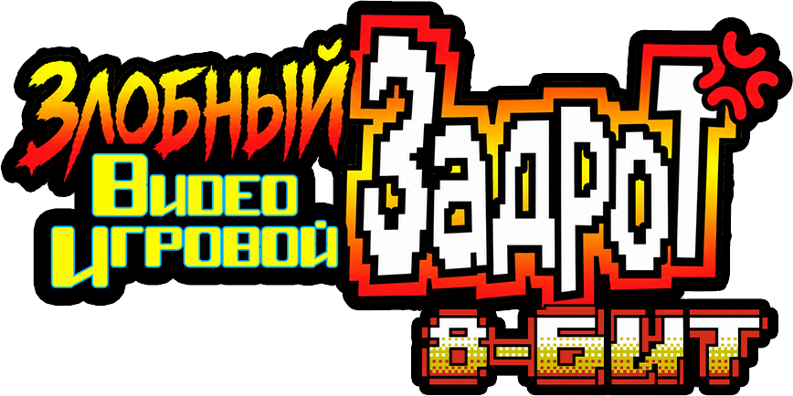
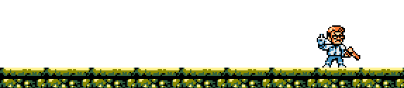

<h1 align="center">The Angry Video Game Nerd 8-bit (Русская версия 🇷🇺)</h1>

Ну что, детишки? Никто этого перевода не ждал, а я его взял и сделал. Почему? Да потому, что я сам ждал эту игру и собирался её купить. Но игра утекла в Сеть, а все картриджи уже раскупили. В общем, русскоязычные игроки теперь смогут насладиться этой замечательной...

Да ладно, я шучу! **Игра — отстой!** Лишь блеклая тень той версии, что вышла на современных платформах.

Не поймите меня неправильно. Тут крутая графика, крутая музыка, диалоги с матюгами... Но, увы, в игре не реализовали и половины того, что хотелось бы увидеть. Да и что тут вообще происходит? Как Задрот попал в игровой мир? Что ему надо делать и зачем? Я не знаю.

Зато теперь всё это безобразие можно пройти на русском языке!

# 📖 Короче, что там с переводом?

**В игре переведено:**

- Все диалоги, включая сюжетные заставки и концовку. Концовки от режима сложности не зависят, кстати.
- Все встречающиеся системные сообщения, такие как **ОШИБКА!**, **ПАУЗА!**, **ИГРА ОКОНЧЕНА** и прочие.
- Главное меню, выбор сложности и остальные игровые надписи.
- Финальные титры, включая должности разработчиков.
- Графические надписи, включая главный логотип и команды босса-самолёта.

Ну и разумеется, я не стал цензурить матюги. Это же AVGN, чёрт возьми!

**Что НЕ переведено:**

- То, что я так и не смог найти в самой игре. Например, здоровенная коронная фраза Задрота **WHAT WERE YOU THINKING?!!**. В ROM-файле она есть, но в процессе игры мне так и не встретилась. Если обнаружится, где она используется, обязательно переведу.
- Пароли. Они остались на английском, включая знаменитый чит-код на бессмертие **IDDQD**.
- Оригинальные названия компаний, имена и некоторые технические обозначения, которые разумнее оставить на английском.

**Что тестировалось:**
Я постарался проверить все уровни, заставки, десяток раз прошёл игру на разных уровнях сложности, но никогда нельзя исключать, что где-нибудь притаился очередной баг, который решил испортить вам жизнь.

# 🛠️ А как же версия с трейнером?

Ну как же без неё! В архиве находятся два патча — обычный и со встроенным трейнером.

Нажмите во время игры **ВВЕРХ + START**, и вам будут дарованы бесконечные жизни, а враги больше не смогут вас кусать. Зато смогут толкаться! Причём так, что запросто спихнут в яму, и придётся начинать комнату заново.

Повторное нажатие **ВВЕРХ + START** отключает этот странный режим.

Так что даже с читами расслабляться не советую!

# 🧩 Как установить перевод?

Для установки понадобится чистый образ игры:

**`Angry Video Game Nerd 8-bit, The (USA) [Rev A].nes`**

**MD5:**

`8da22800c5ea6637e8a4c4b4f0bb3807`

1. Скачайте патч русификации из раздела **Releases**.
2. Примените его к чистому образу игры с помощью программы для установки IPS-патчей, например Floating IPS (Flips).
3. Запустите получившуюся ROM в совместимом эмуляторе NES.

> **Внимание!** Патч предназначен для версии **USA Rev A**. На других версиях игры его работа не гарантируется. Оригинальная игра в архив перевода не входит.

## ❓ F.A.Q.

- **А где скачать игру? Я не могу её найти! Скинь по-братски?** — *В интернете она есть. Если не можешь найти — ты не достоин этой игры. Живи с этим.*
- **Тебе не стыдно выпускать перевод с МАТАМИ?** — *Ни грамма. Испокон веков все реплики AVGN'а переводят от души и с матами, да и из песни слов не выкинешь.*
- **Я умудрился поймать баг! Это плохой перевод!** — *В игре пришлось немало повозиться с размещением текста: русские фразы часто длиннее английских, а свободного места в ROM почти нет. Где-то что-то я мог и упустить, но если ты подробно напишешь, где встретил этот баг, — постараюсь его исправить.*
- **Ты что, пользуешься нейросетями для перевода, ромхакинга и всего такого!?** — *Да, и даже не одной, чем и горжусь. В наше время люди либо пользуются нейросетями, либо врут о том, что не пользуются. Я из первых.*

Перевод на русский язык — Black Ace © 2026.

Оригинальная игра и все связанные с ней товарные знаки принадлежат их правообладателям. Это неофициальный фанатский перевод.

